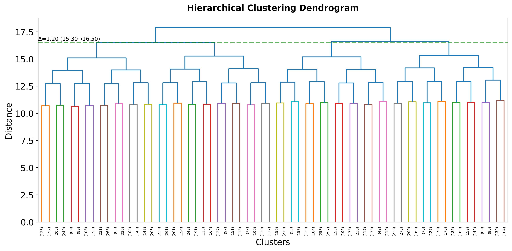
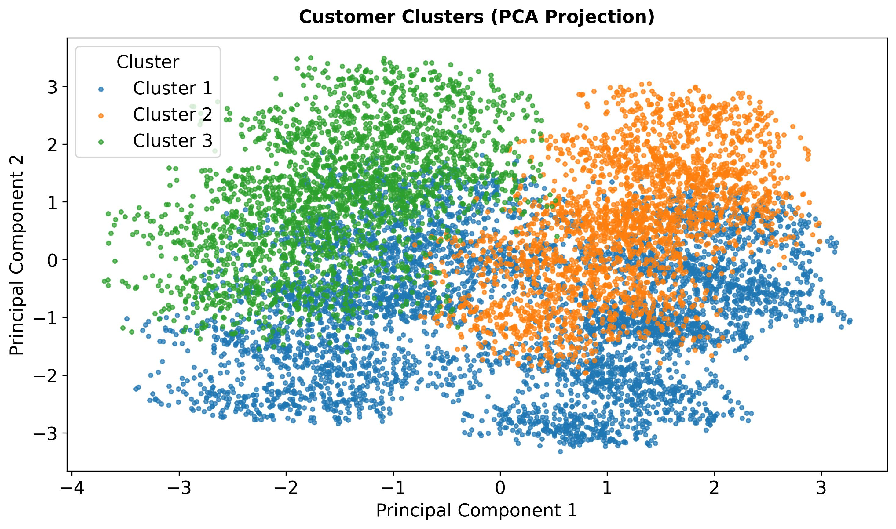

# Customer Segmentation — Hierarchical Clustering with Gower Distance

A customer segmentation pipeline that groups telecom customers into distinct behavioral segments using **agglomerative hierarchical clustering** on a mixed dataset of continuous and categorical variables. Rather than discarding categorical features or applying k-means, Gower distance is used to compute unified similarity across both data types — enabling more realistic segmentation without compromising feature coverage.

> **Dataset Note**
> The raw dataset has been removed from this repository for data ethics reasons. All figures and visualizations generated during the analysis are retained in the `Figures/` folder for reference and portfolio purposes.

---

## Research Question

Can a telecommunications company's customers be grouped into distinct segments based on demographic, service, and account characteristics to uncover behavioral patterns that inform targeted retention strategies?

---

## Why Hierarchical Clustering — and Why Gower Distance

The dataset contains a mix of continuous variables (tenure, charges, bandwidth usage) and categorical variables (contract type, payment method, streaming services). **K-means cannot handle categorical data natively** — it requires purely numeric input and assumes spherical clusters.

Hierarchical clustering with Gower distance solves both problems:

- **Gower distance** computes a unified similarity score across mixed data types: Manhattan distance for continuous variables, simple matching for categorical ones — normalized to [0, 1] per feature.
- **Average linkage** was selected over single or complete linkage because it considers all pairwise distances between clusters, reducing sensitivity to noise and outliers without over-compacting dense clusters.
- **Agglomerative (bottom-up)** approach builds a hierarchy from individual observations, enabling dendrogram-based inspection of natural cluster structure.

---

## Feature Selection

| Variable | Type | Why Included |
|---|---|---|
| `Tenure` | Continuous | Measures customer loyalty and churn risk |
| `MonthlyCharge` | Continuous | Represents customer value |
| `Bandwidth_GB_Year` | Continuous | Captures service usage behavior |
| `Income` | Continuous | Indicates purchasing power |
| `Outage_sec_perweek` | Continuous | Reflects service quality experience |
| `Contract` | Categorical | Strong predictor of churn behavior |
| `InternetService` | Categorical | Service type segmentation |
| `TechSupport` | Categorical | Support engagement |
| `DeviceProtection` | Categorical | Add-on adoption behavior |
| `StreamingTV` | Categorical | Usage pattern — emerged as a key cluster differentiator |
| `PaymentMethod` | Categorical | Financial behavior |
| `PaperlessBilling` | Categorical | Digital engagement preference |

---

## Preprocessing Decisions

**Missing values → preserved as a category.**
`InternetService` contained 2,129 missing values — 21% of the dataset. Dropping these rows would introduce systematic bias (non-internet customers form a meaningful segment). Instead, missing values were filled with `"None"`, treating them as a distinct "no internet service" category. This preserves segment integrity and is compatible with Gower distance.

**Normalization → MinMaxScaler.**
Continuous variables were scaled to [0, 1] before Gower matrix computation. Without normalization, high-range variables (e.g., `Income`) would dominate distance calculations regardless of actual importance.

**Categorical encoding → string cast.**
The `gower` library requires categorical features to be typed as non-numeric strings. No one-hot encoding is applied at this stage — Gower handles categorical similarity natively.

---

## Optimal Number of Clusters

Linkage distances were extracted from the hierarchical merge sequence, and consecutive differences were computed to identify the largest dissimilarity jump. Rather than accepting the global maximum (which yielded 31 clusters), the search was constrained to solutions with **2–6 clusters** to maintain interpretability.

The largest jump within that range occurred at **15.11 → 16.34 (Δ = 1.22)**, corresponding to a cut threshold of **16.34** — yielding **3 clusters**.

| Dendrogram |
|---|
|  |

---

## Cluster Visualization

PCA reduces the high-dimensional feature space to 2D for visualization. It is applied only after clustering is complete — cluster assignments are based on the full Gower distance space, not on PCA components.

| PCA Projection |
|---|
|  |

---

## Cluster Profiles and Key Finding

| Cluster | Tenure | Monthly Charge | Streaming | Interpretation |
|---|---|---|---|---|
| 1 | Very low | Moderate | Mixed | New / early-stage customers — higher churn risk |
| 2 | High | Low | No | Stable but low-engagement users |
| 3 | High | Highest | Yes | High-value, fully engaged customers |

**Notable finding:** `StreamingTV` emerged as the primary differentiator between Cluster 2 and Cluster 3, despite streaming appearing as one of seven categorical variables. `Contract`, `InternetService`, and `PaymentMethod` showed minimal variation across clusters — meaning account configuration factors are weaker segmentation signals than behavioral variables like tenure and streaming usage.

---

## How to Run

```bash
pip install -r requirements.txt
python main.py
```

Outputs are saved automatically to `Figures/`.

---

## Project Structure

```
project/
├── data/                    # Raw dataset (removed — data ethics)
├── Figures/                 # Dendrogram, PCA cluster plot
├── main.py                  # Full pipeline — preprocessing through visualization
├── requirements.txt
└── README.md
```

## Tech Stack

`Python` · `pandas` · `numpy` · `gower` · `scipy` (`linkage`, `dendrogram`, `fcluster`) · `scikit-learn` (`MinMaxScaler`, `PCA`, `StandardScaler`) · `matplotlib`
